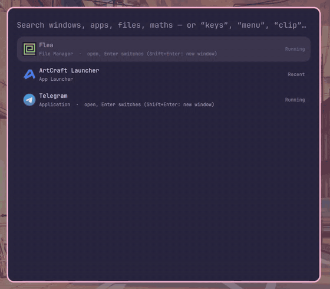

# Super Spaces

A tidier workspace bar and a Raycast-style search for [Omarchy](https://omarchy.org/).




- **Bar:** workspaces above 9 fold away behind `+N`, so the bar stays short.
- **Search (Super + Space):** windows, apps, files, quick maths, the Omarchy
  menu, shortcuts, clipboard history and your AI agents, all in one box.
- **Light:** it runs inside the Omarchy shell you already have. Almost no
  memory when closed, about 7 MB while open.

## Install

```bash
omarchy plugin add https://github.com/achardz/omarchy-super-spaces.git --enable
omarchy restart shell
omarchy pkg add fd wl-clipboard
```

Then give the search a key: see [Getting started](docs/getting-started.md).

## Docs

| Page | What's in it |
|---|---|
| [Getting started](docs/getting-started.md) | install, set the key, your first minute, keys |
| [The bar](docs/bar.md) | folding workspaces, the `+N` button |
| [Searching](docs/search.md) | what you can type, closing and moving windows, nicknames |
| [Omarchy menu, shortcuts and clipboard](docs/omarchy.md) | `menu`, `keys`, `clip` |
| [AI agents](docs/ai.md) | find past sessions (`ai`), ask questions (`ask`) |
| [Settings](docs/settings.md) | turn results on and off, where things are saved |
| [Extras](docs/extras.md) | Super + N workspace picker, a Setup page in the Omarchy menu |
| [Questions and fixes](docs/faq.md) | common problems, removing it |

## Cheat sheet

| Type | Get |
|---|---|
| an app, window or file name | open / jump to it |
| `12*7` | the answer (Enter copies) |
| `14` | go to workspace 14 |
| `menu …` | the Omarchy menu |
| `keys …` | Omarchy shortcuts |
| `clip …` | clipboard history |
| `ai …` | past AI agent sessions |
| `ask …` | ask your AI agent (off until you turn it on) |
| `settings` | turn results on and off |

## License

MIT — based on Omarchy's `omarchy.workspaces` widget.
